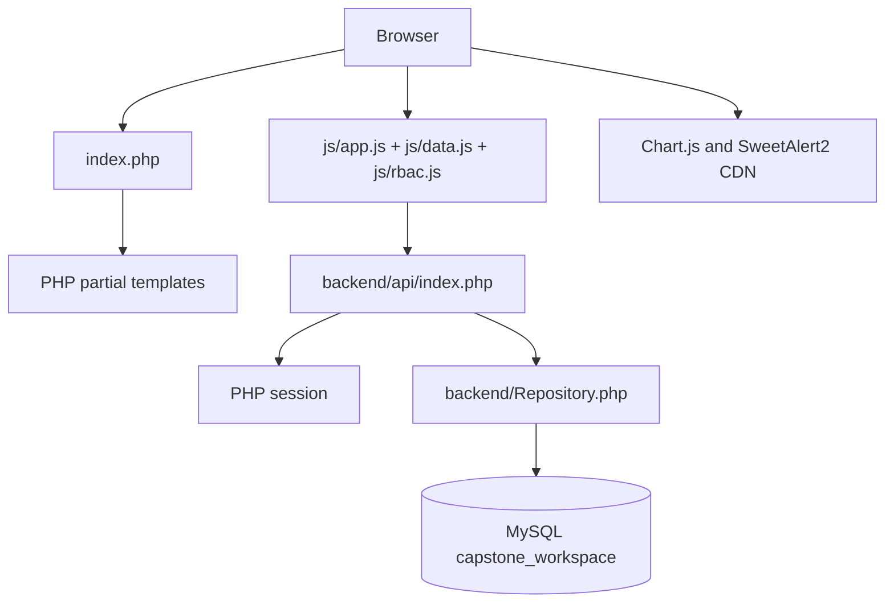
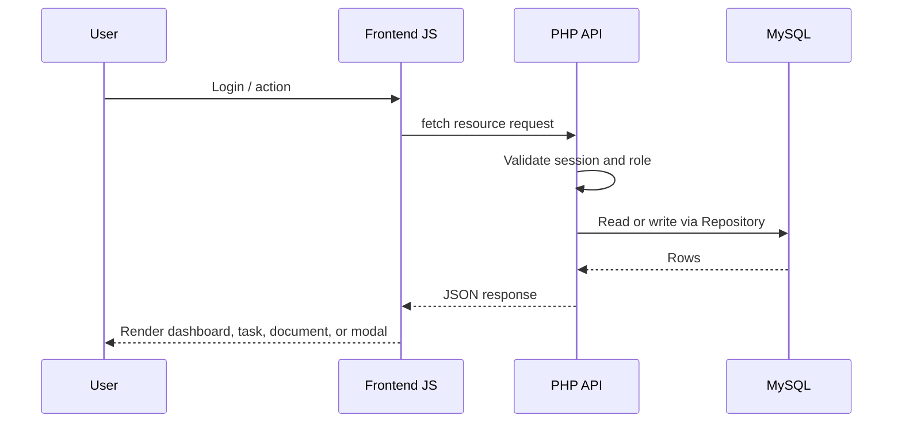
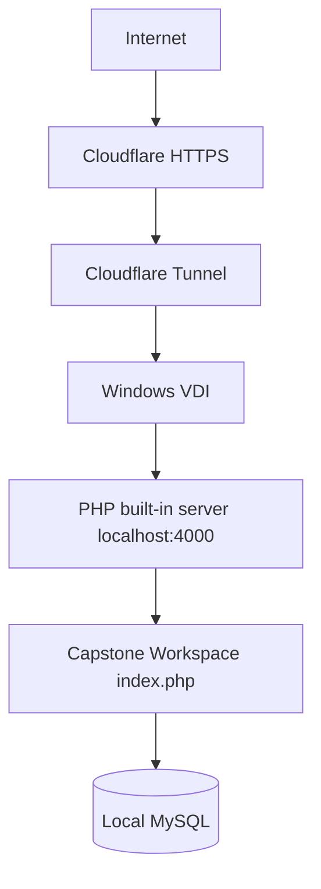

# Architecture

## Current Stack

- PHP without Laravel or another backend framework.
- MySQL via PDO.
- HTML/PHP partials.
- CSS in `css/style.css`.
- JavaScript in `js/app.js`, `js/data.js`, and `js/rbac.js`.
- Chart.js from CDN.
- SweetAlert2 from CDN.
- Cloudflare Tunnel for public access.

## Major Modules

| Area | Files |
|---|---|
| App shell | `index.php`, `partials/sidebar.php`, `partials/top-header.php`, `partials/login.php` |
| Pages | `partials/pages/*.php` |
| Modals | `partials/modals/*.php` |
| Frontend orchestration | `js/app.js` |
| Frontend data/API layer | `js/data.js` |
| Frontend RBAC helper | `js/rbac.js` |
| API routing and authorization | `backend/api/index.php` |
| Data access | `backend/Repository.php` |
| BA draft/recovery storage | `backend/BeritaAcaraStorage.php` |
| Database connection | `backend/Database.php`, `backend/config.php` |
| Schema and migrations | `database/schema.sql`, `database/migrations/*.sql` |

## Runtime Flow

## Data Flow

## Important Interfaces

- `GET backend/api/index.php?resource=snapshot`
- The frontend uses `resource=snapshot&include_logs=0` for ordinary loads. The superadmin Audit page loads audit/activity endpoints on demand; the default snapshot remains backwards compatible.
- `POST backend/api/index.php?resource=auth`
- `DELETE backend/api/index.php?resource=auth`
- `GET/POST/PUT/DELETE resource=tasks`
- `GET/POST/PUT/DELETE resource=meetings`
- `GET/POST/PUT/DELETE resource=users`
- `PUT resource=users&id=...` with `action=set_status` and boolean `isActive`: superadmin-only account status transition, transactional status/audit write. `users.is_active` defaults to 1; migration 007 is CLI-only and never applied by Repository construction.
- `GET/POST resource=notifications`
- `GET/POST/DELETE resource=audit-logs`
- `GET/POST resource=user-activities`
- `GET/POST/DELETE resource=guides`
- `GET/POST/PUT/DELETE resource=document-archives`
- `GET/PUT resource=progress-notes`
- `GET/POST resource=rbac`
- `GET resource=phase-access&phase=tugas1|tugas2|tugas3`: authenticated, page-permission-gated minimal team access summary.
- `POST resource=presence`: authenticated foreground heartbeat updating the session user's existing last-seen timestamp; no audit entry per heartbeat.
- `GET/PUT resource=ba-drafts&meeting_id=...` and `POST resource=ba-drafts`: manager-only draft reads/versioned saves and safe legacy import.
- `POST resource=browser-backups`: immutable original work-key snapshot; GET list/detail is superadmin-only.

## Storage And Database Behavior

- Main data is stored in MySQL.
- Uploaded guides and archive documents are stored as BLOBs.
- Timestamps are stored in UTC at the database level. Frontend renders WIB.
- `Repository::create()` performs some table and column setup for compatibility.
- LocalStorage is still used for cached/offline fallback and UI preferences.
- Online business records are server-authoritative and no longer written into legacy work-cache keys. BA drafts use MySQL; original browser work is retained until backed up/imported without overwrite. Identity/permission UI cache and device display preferences are not project-data authority.
- Business mutations await API confirmation and apply the returned server data. Task PUT requests carry edited fields rather than the complete cached task and its meetings.

BA numbering is server-owned in `berita_acara_drafts.payload.documentNumber`, serialized by an advisory lock and transaction. Archive filenames reserve existing codes; same-meeting manual/draft records share a number, including uniquely date-matched legacy uploads with missing links. Ambiguous dates are not merged. Assigned codes are not automatically renumbered. This uses existing tables, not a schema migration.

## External Services

- Cloudflare Tunnel routes public HTTPS traffic to local PHP server.
- CDN loads Chart.js and SweetAlert2.
- No VPS is used according to the deployment handoff.

## Security And Privacy-Relevant Behavior

- PHP sessions use `httponly`, `samesite=Lax`, and `secure` when HTTPS is detected.
- Passwords are stored as password hashes.
- Backend validates role permissions before non-auth API requests.
- Member task updates are restricted to their own PIC tasks, with review exceptions.
- Audit logs and user activity logs may store IP and device/user-agent.
- File downloads stream from API with `X-Content-Type-Options: nosniff`.

## Deployment Shape

